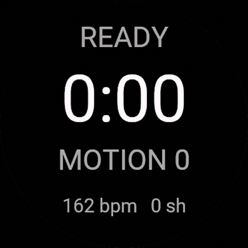
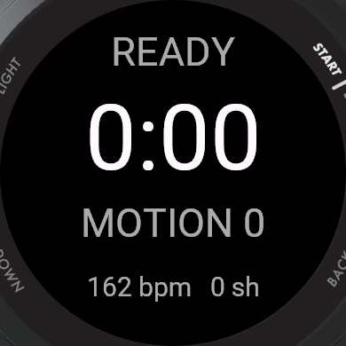
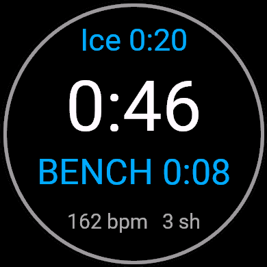
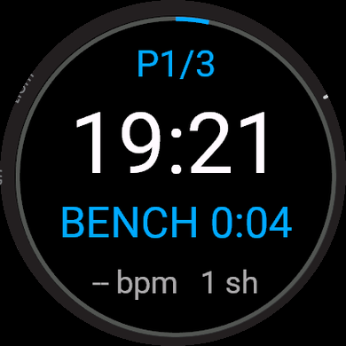
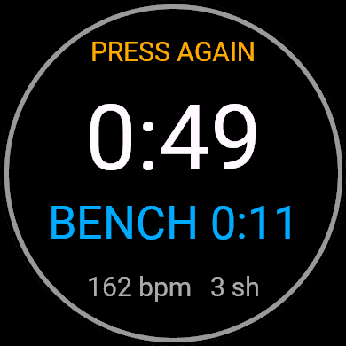
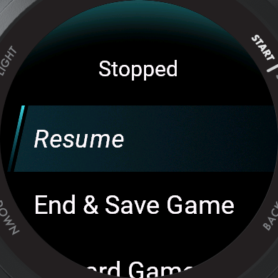
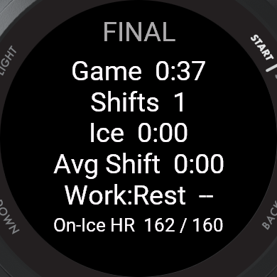

# Garmin Hockey Tracker

A Connect IQ watch app that tracks an ice hockey game from your wrist **without
being touched**. One press at the opening faceoff; after that it works out
every shift and every spell on the bench by itself and keeps recording until
you stop it. It records a real hockey activity that syncs to Garmin Connect.

Built and tested on the **Forerunner 570**. The layout is resolution-independent,
so the same build runs across the Garmin watch range.

<p align="center">
  
</p>
<p align="center">
  <sub>A short game tracked end to end &middot;
  <a href="https://youtu.be/LM8cZ_diB8s">the same clip in 1080p</a></sub>
</p>

<p align="center">
  
  
  
</p>
<p align="center">
  
  
  
</p>
<p align="center">
  <sub>Ready &middot; on the ice &middot; on the bench &middot; pausing asks twice &middot; the stop menu &middot; final summary</sub>
</p>

---

## What it does

- **Automatic shift detection** — no button per line change. The app decides
  when you are on the ice and when you are on the bench, and splits the
  activity accordingly.
- **One continuous game clock** — no periods to set up and nothing that ends
  the activity on a schedule. A real game runs longer than the sum of its
  periods, so the recording stops when you stop it and not before.
- **Shift clock** — green → amber → red as the shift runs long, with a long,
  full-strength buzz at your target length so it is felt through a glove. The
  ring around the screen fills with it, readable without reading a number.
- **Total ice time on screen all game**, not only in the summary afterwards.
- **On-ice heart rate, separated from bench heart rate** — the number this app
  exists to produce. See below.
- **GPS on** — speed and distance are recorded when a fix is available.
- **One screen** — everything visible at a glance, no paging mid-game.

```
       Ice 14:06            total time on the ice so far
      ┌─────────────┐
         42:18              the game clock, counting up
       ON 0:42              green → amber → red; BENCH in blue
      148 bpm  9 sh         heart rate and shifts so far
      └─────────────┘
          the outer ring fills as the current shift runs toward its target
```

## How the shift detection works

Three signals are available and they are not equally good:

| Signal | Latency | What it is good for |
|---|---|---|
| **Wrist motion** | ~1 s | The only signal that responds fast enough, and the only one that separates skating from standing on the bench. Noisy. |
| **Heart rate** | 20–60 s | Reliable but far too slow to open or close a shift. HR keeps climbing after a shift ends and falls for a minute afterwards. |
| **GPS speed** | instant, when it exists | Unambiguous — nobody reaches 3 m/s on a bench — but indoor rinks usually never get a fix. |

So motion decides, and the other two only corroborate:

- The measure is the **mean absolute deviation of the acceleration magnitude**
  over each second. Taking the magnitude removes the watch's orientation from
  the answer; taking the deviation about the mean removes gravity. What is left
  is how much the arm actually moved.
- Thresholds are **learned during the game**, not hard-coded, because the
  absolute numbers depend on the player, where the watch sits and how tight the
  strap is. The app tracks a slow estimate of your resting level and your
  working level and puts the boundary between them.
- A change is only believed once it **persists**: six seconds to open a shift,
  ten to close one, with a dead band around the boundary so noise cannot make
  the state flap. Heart rate climbing, or GPS agreeing, shortens those windows.
- Because a boundary is confirmed late, it is **dated back** to when it actually
  happened. Without that, every shift would lose its first seconds to the bench
  and every bench spell its first seconds to the shift.

It will get some boundaries wrong. `BACK` — the lap key — flips the state by
hand when it does, and the menu offers the same correction in words.

The band the boundary sits in was fitted to a real game rather than guessed;
[docs/detector-tuning.md](docs/detector-tuning.md) records the method, the
numbers and what one game does not prove.

## Why on-ice heart rate is the point

In a simulated game of elite U20 players, average heart rate **on the ice** was
**84 ± 2 % of maximum**, peaking at **97 ± 2 %**.¹ Those are on-ice numbers: the
study reports no whole-game average, because once bench time is averaged in the
figure stops describing the skating and starts describing the proportion of the
night you spent sitting down.

That is the problem with a game average. It is a weighted blend of two states,
and the weighting is your bench time, not your effort. Two players who skated
identically can post different game averages purely because one got more rest.
A chest strap with no idea when you were on the ice cannot separate them.

This app knows when you were on the ice, so it reports both.

<sub>¹ Vigh-Larsen et al., "Muscle Metabolism and Fatigue during Simulated Ice
Hockey Match-Play in Elite Players", <i>Medicine & Science in Sports &
Exercise</i> 52(10):2162-2171, 2020. Thirty U20 national-team players, three
periods of eight one-minute shifts with two-minute recoveries - a fixed shift
structure, not a real game's ragged one.</sub>

## Controls

Laid out the way Garmin's own activities are, so muscle memory from the stock
Run app transfers. Nothing here is needed during normal play.

| Button | Action |
|---|---|
| `START` / `STOP` | Start the game. **Press twice** to stop into the stop menu — resume, save, discard — exactly as stopping a run does. |
| `BACK` (`LAP`) | Line change. `BACK` is the lap key in every Garmin activity, and a lap here *is* a shift, so this is the button that corrects the detector when it has the state wrong. |
| `UP` / `DOWN` | Nothing. There is one data screen by design, so there is nothing to page through. |
| `MENU` (hold `UP`) | Correct the shift state, pause, end or discard the game. Only while a game is open. |

Two things follow from that, and both are deliberate departures from where this
app started:

- **`BACK` no longer ends the game.** On a Garmin watch `BACK` is never the exit
  during an activity, and a knock against the boards should not be able to end a
  game. Ending now goes through the stop menu: `START`, then *End & Save*.
- **`DOWN` does nothing.** It used to end the period, and a mis-press inside a
  glove could burn one. There are no periods now, so there is nothing to burn.
- **Pausing takes two presses.** The first buzzes twice and shows `PRESS AGAIN`
  without stopping anything, and lapses after five seconds if the second never
  comes.
- **The glass is ignored while a game is live.** This watch maps touch straight
  onto the same behaviours as the buttons — a tap arrives as `SELECT`, exactly
  like `START`, and a swipe right arrives as `BACK` — so a glove or a sleeve
  across the display used to stop the recording or fake a line change. A game on
  2026-11-03 lost seven minutes that way, in two pauses nobody meant to make.

  Touch is told apart from the buttons by what precedes it: a physical button
  raises a key event immediately before its behaviour, and the touchscreen
  raises none. While a game is running or paused, a behaviour that arrives
  without one is dropped. The menus are separate screens and still take touch
  normally, so this costs nothing once a menu is deliberately open.
- **Ending a game asks first.** *End & Save* is irreversible mid-game and the
  stop menu is where an accidental pause lands you, so it now confirms — as
  *Discard* always did.

## Wear it on your wrist

Shifts come from wrist motion, so the watch has to be on the arm. Carried in a
vest pocket or a bag it has nothing to detect: the detector never flips, and
the game records as one shift the length of the game. This comes up because
plenty of players wear a chest strap and stow the watch - the strap is fine and
is used for heart rate exactly as normal, but it cannot stand in for the one
signal the detection actually runs on.

## Settings

Editable in Garmin Connect; the defaults are a regulation game.

| Setting | Default | Range |
|---|---|---|
| Shift alert | 60 s | 15–600 |
| Shift sensitivity | Normal | Low / Normal / High |
| Shift alerts | on | |
| Lap per shift | on | |
| Use GPS | on | |
| End game when idle | 25 min | 0–180, 0 = never |
| Activity type | Ice Hockey | Ice Hockey / Ice Skate |

**Shift sensitivity** moves the decision boundary within the learned band. High
means less movement counts as being on the ice — raise it if shifts are being
missed, lower it if standing on the bench is being counted as a shift.

**End game when idle** saves a game nobody is playing any more. After this
many minutes with no skating detected the watch buzzes long-short-long and
shows a red *ENDING GAME* countdown; any button press cancels it and starts the
count again. Left alone for thirty seconds it **saves** the activity rather
than discarding it, because the premise of the app is that the watch is not
being touched, so silence has to mean keep the game.

Three things hold it back, and each is there because the alternative is ending
a game that is still being played:

- **A press has to be a press.** A swipe arrives as the same behaviour as a
  button on some devices, so cloth moving against the glass in a bag would
  otherwise reset the clock forever and the recording would run all night.
- **It stops while the accelerometer is unhealthy.** The detector holds its
  last state through a silent sensor rather than guessing, so reading that held
  state as stillness would turn a dead sensor into an ended game. No data is
  not the same as no movement.
- **It suspends while a menu is open**, because the countdown cannot be shown
  there and no press can reach it. Failing to end a game is recoverable;
  ending one silently is not.

This is not the period clock coming back. That ended a game on a *schedule*,
which knows nothing about whether play is still going, and it cut a recording
short mid-shift. This ends on *evidence that nothing is happening*. The
distinction is why the default is twenty-five minutes: an intermission is a
normal fifteen to eighteen minutes of sitting down, and the threshold has to
clear it comfortably or the old bug is back. Set 0 to turn it off.

**There is no period setting, and that is deliberate.** The app used to run
three twenty-minute periods and end the activity when the last one expired. It
did exactly that on 2026-11-03, at 3600.79 seconds of clock time — three
periods to the second — while the game was still being played, and the last
nine minutes of it were never recorded. The periods were a fiction regardless:
the app has no way to know the real game clock, which stops for whistles and
penalties and everything else the watch cannot see, so they drifted from the
game's within minutes. A game is now one continuous recording.

**Use GPS** is on because speed and distance are worth having when a fix exists.
Expect no fix inside most arenas; the app degrades quietly to motion-only
detection and records the game normally.

**Activity type** decides the FIT sport the finished game is filed under, and
it is a straight trade:

| | Garmin Connect | Strava |
|---|---|---|
| **Ice Hockey** (default) | Ice hockey | A plain *Workout* |
| **Ice Skate** | Ice skating | *Ice Skate* |

Strava has no ice hockey type and has said it has no plans to add one, so a
hockey-typed game arrives there untyped. Ice skating — FIT sport 33 — is the
closest thing Strava understands, and switching to it costs only the label in
Garmin Connect. Everything else, including every field below, is unaffected.
The setting is read when a game starts, so changing it never retypes an
activity that is already recording.

## What lands in Garmin Connect

The activity records as FIT sport `hockey`, sub-sport `ice`, with heart rate,
calories, time and — where there was a fix — GPS. On top of that:

| Field | Scope | Meaning |
|---|---|---|
| Shifts | session | Number of shifts |
| Ice Time | session | Total seconds on the ice |
| Bench Time | session | Total seconds on the bench |
| Avg Shift / Longest Shift | session | Shift lengths in seconds |
| Rest per Work (×100) | session | Bench seconds per ice second, ×100 |
| On-Ice Avg HR | session | Average heart rate over on-ice seconds only |
| Time above 85 % HR | session | Seconds above 85 % of max heart rate |
| Shift Time / Bench Time | lap | One lap per shift and one per bench spell, so the Splits tab reads as a shift chart |
| On Ice | record | 1 on the ice, 0 on the bench — a square wave against the heart rate trace |
| Shift Time (live) | record | The running shift clock |
| Wrist Motion | record | The raw signal the detector ran on, in milli-g |
| Detection Threshold | record | The learned boundary it was judged against |

The last two are diagnostics. Garmin does not record wrist acceleration into a
FIT file, so unless the app writes it itself the signal the detector ran on is
gone the moment the game ends. Charted against each other they show every
decision the app made and why, which is what makes the thresholds tunable
against real skating rather than guesswork.

Developer fields only render once the app is on the store — a Beta upload is
enough. A sideloaded build writes them correctly and displays them nowhere.

## Install

**From the Connect IQ Store** — the ordinary way, and the only way the developer
fields show up in Garmin Connect. Listed once Garmin's review completes.

**By sideloading** — every [release](../../releases) carries two files:

| File | What it is |
|---|---|
| `IndoorHockey.prg` | A single build for the Forerunner 570. Copy it to `GARMIN/APPS/` on the watch over USB and eject, or run `tools/watch.sh install IndoorHockey.prg`. |
| `IndoorHockey.iq` | The store package: the same app built for all 202 supported device variants. This is what gets uploaded to Garmin, not what gets copied to a watch. |

For any watch other than a Forerunner 570, build the `.prg` yourself —
`./build.sh <device>`, see [Build from source](#build-from-source). The `.iq` is
an archive, not something a watch can open.

The app then appears in the activity list. One thing to know before sideloading:
**developer fields only render in Garmin Connect for an app that came from the
store.** A sideloaded build writes shift and bench time into the FIT file
correctly, and Garmin Connect displays none of it. The on-watch summary and the
lap splits still work.

## Publishing

```bash
cd IndoorHockey
./package.sh               # builds bin/IndoorHockey.iq for every product
```

Upload that at <https://apps.garmin.com/en-US/developer/upload>; the dashboard
for an app already up is <https://apps-developer.garmin.com>. `store/listing.md`
holds the description, category and screenshot order to paste into the form.

Launcher icons are generated, not hand-drawn, because the supported watches ask
for fifteen different sizes between 26x26 and 70x70:

```bash
python3 tools/make-launcher-icons.py   # after changing the device list
```

## Build from source

Requires the [Connect IQ SDK](https://developer.garmin.com/connect-iq/sdk/) and
device files, which the Garmin SDK Manager downloads after you sign in with a
Garmin account.

```bash
cd IndoorHockey
./build.sh                 # Forerunner 570 42mm
./build.sh fenix847mm      # any installed device
./run-sim.sh               # build and run in the Connect IQ simulator
TYPECHECK=3 ./build.sh     # strict type checking
```

`./sync-products.sh` rewrites `<iq:products>` in `manifest.xml` to exactly the
devices installed locally that meet the app's `minApiLevel` — run it after
adding devices, before building a store package.

### Running the tooling on Ubuntu 24.04

The SDK Manager and the simulator both link `webkit2gtk-4.0` (libsoup2).
Ubuntu 24.04 ships only `webkit2gtk-4.1` (libsoup3), and loading both into one
process aborts with `libsoup2 symbols detected`. Symlinking 4.1 as 4.0 does not
work either.

`tools/sdkmanager-docker/` solves this with an Ubuntu 22.04 container that reads
and writes the real `~/.Garmin`, so downloaded device files land where `monkeyc`
expects them:

```bash
tools/sdkmanager-docker/run.sh             # SDK Manager GUI
tools/sdkmanager-docker/run-simulator.sh   # Connect IQ simulator
```

Both honour `$DISPLAY`, so they work over X11 forwarding or against a virtual
display on a headless box.

## Layout

```
IndoorHockey/
  manifest.xml         app id, device list, permissions
  monkey.jungle        build config
  build.sh             compile for one device
  package.sh           build the signed .iq for every supported device
  run-sim.sh           build + launch in the simulator
  sync-products.sh     regenerate the device list from what is installed
  source/
    IndoorHockeyApp.mc entry point, the 1 Hz game clock, settings reload
    GameModel.mc       clocks, shifts, heart rate stats, the FIT session
    ShiftDetector.mc   on-ice / on-bench detection
    GameView.mc        the one screen, plus the post-game summary
    GameDelegate.mc    buttons
    GameMenu.mc        in-game menu
    Fmt.mc             time formatting
  resources/
    fitfields.xml      how the developer fields render in Garmin Connect
    strings/           every user-visible string
    settings/          properties and their Garmin Connect settings UI
    drawables/         launcher icon
tools/
  replay_detector.py   replay a recorded game through the detector offline
  sdkmanager-docker/   containerised SDK Manager + simulator
docs/
  screenshots/         simulator captures used above
  detector-tuning.md   how the detection band was fitted, and to what
```

### Design notes

All game state lives in `GameModel`; views read it and draw, holding none of
their own.

The 1 Hz game clock is owned by the **app**, not the view, so shift detection,
alerts and the per-second FIT fields keep running while a menu or a confirmation
is covering the screen.

The game clock is game time; **shift and bench time are wall time**. Recovery
happens during whistles too, so a bench spell that spans a stoppage really is
longer than the game clock says it is.

Clocks are "time already banked" plus "running since", measured with
`System.getTimer()`, so pausing and resuming cannot drift.

Text is never positioned in fixed pixels. Each line picks the largest font that
fits the **chord of the circle at that height** — on a round watch the usable
width near the top and bottom is far narrower than the diameter, which is what
makes naively-sized text spill off the edge.

Vibration patterns are deliberately long and at full strength. A short, gentle
buzz is perfectly clear on a bare wrist and completely undetectable under a
glove, an elbow pad and a jersey sleeve, which is where this app is.

## Licence

MIT — see [LICENSE](LICENSE).
