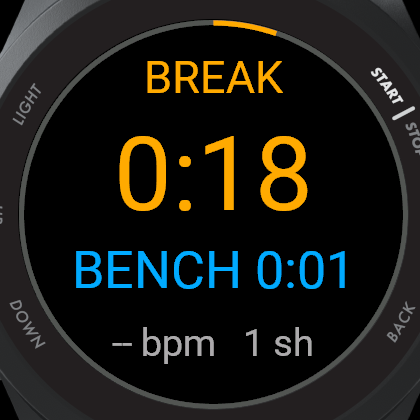

# Garmin Hockey Tracker

A Connect IQ watch app that tracks an ice hockey game from your wrist **without
being touched**. One press at the opening faceoff; after that the app runs the
periods, runs the intermissions, and works out every shift and every spell on
the bench by itself. It records a real hockey activity that syncs to Garmin
Connect.

Built and tested on the **Forerunner 570**. The layout is resolution-independent,
so the same build runs across the Garmin watch range.

<p align="center">
  
  
  
</p>
<p align="center">
  
  
  
</p>
<p align="center">
  <sub>Ready &middot; on the ice &middot; on the bench &middot; intermission &middot; menu &middot; final summary</sub>
</p>

---

## What it does

- **Automatic shift detection** — no button per line change. The app decides
  when you are on the ice and when you are on the bench, and splits the
  activity accordingly.
- **Period clock** — 3 × 20 minutes by default, ends itself at zero with a
  double buzz, and starts the next period after a one-minute intermission
  without being asked.
- **Shift clock** — green → amber → red as the shift runs long, with a long,
  full-strength buzz at your target length so it is felt through a glove.
- **On-ice heart rate, separated from bench heart rate** — the number this app
  exists to produce. See below.
- **GPS on** — speed and distance are recorded when a fix is available.
- **One screen** — everything visible at a glance, no paging mid-game.

```
         P2/3                period
      ┌─────────────┐
         12:34              period clock (or the intermission countdown)
       ON 0:42              green → amber → red; BENCH in blue
      148 bpm  9 sh         heart rate and shifts so far
      └─────────────┘
          the outer ring fills as the period runs out
```

## How the shift detection works

Three signals are available and they are not equally good:

| Signal | Latency | What it is good for |
|---|---|---|
| **Wrist motion** | ~1 s | The only signal that responds fast enough, and the only one that separates skating from standing on the bench. Noisy. |
| **Heart rate** | 20–60 s | Reliable but far too slow to open or close a shift. HR keeps climbing after a shift ends and falls for a minute afterwards. |
| **GPS speed** | instant, when it exists | Unambiguous — nobody reaches 3 m/s on a bench — but indoor rinks usually never get a fix. |

So motion decides, and the other two only corroborate:

- The measure is the **mean absolute deviation of the acceleration magnitude**
  over each second. Taking the magnitude removes the watch's orientation from
  the answer; taking the deviation about the mean removes gravity. What is left
  is how much the arm actually moved.
- Thresholds are **learned during the game**, not hard-coded, because the
  absolute numbers depend on the player, where the watch sits and how tight the
  strap is. The app tracks a slow estimate of your resting level and your
  working level and puts the boundary between them.
- A change is only believed once it **persists**: six seconds to open a shift,
  ten to close one, with a dead band around the boundary so noise cannot make
  the state flap. Heart rate climbing, or GPS agreeing, shortens those windows.
- Because a boundary is confirmed late, it is **dated back** to when it actually
  happened. Without that, every shift would lose its first seconds to the bench
  and every bench spell its first seconds to the shift.

It will get some boundaries wrong. `UP` flips the state by hand when it does,
and the menu offers the same correction in words.

## Why on-ice heart rate is the point

Measured on the same sixteen players in the same game, average heart rate came
out at **76 % of maximum over the whole game and 84 % counting only the seconds
actually on the ice** — a 21-percentage-point difference produced by nothing but
the averaging window.¹ A game average is diluted by every minute spent on the
bench, and a chest-strap system with no idea when you were on the ice cannot do
anything about it.

This app knows when you were on the ice, so it reports both.

<sub>¹ Vigh-Larsen et al., <i>Medicine & Science in Sports & Exercise</i>, 2020.</sub>

## Controls

Nothing here is needed during normal play.

| Button | Action |
|---|---|
| `START` | Start the game · pause · resume · skip the rest of an intermission |
| `UP` | Correct the detector: flip between on-ice and on-bench |
| `DOWN` | End the period early |
| `MENU` (hold `UP`) | Pause, correct the shift state, end the period, end or discard the game |
| `BACK` | End the game, after a confirmation |

## Settings

Editable in Garmin Connect; the defaults are a regulation game.

| Setting | Default | Range |
|---|---|---|
| Periods per game | 3 | 1–9 |
| Period length | 20 min | 1–60 |
| Intermission | 60 s | 0–1200 |
| Shift alert | 60 s | 15–600 |
| Shift sensitivity | Normal | Low / Normal / High |
| Shift alerts | on | |
| Lap per shift | on | |
| Count period down | on | |
| Use GPS | on | |

**Shift sensitivity** moves the decision boundary within the learned band. High
means less movement counts as being on the ice — raise it if shifts are being
missed, lower it if standing on the bench is being counted as a shift.

**Use GPS** is on because speed and distance are worth having when a fix exists.
Expect no fix inside most arenas; the app degrades quietly to motion-only
detection and records the game normally.

## What lands in Garmin Connect

The activity records as FIT sport `hockey`, sub-sport `ice`, with heart rate,
calories, time and — where there was a fix — GPS. On top of that:

| Field | Scope | Meaning |
|---|---|---|
| Shifts | session | Number of shifts |
| Ice Time | session | Total seconds on the ice |
| Bench Time | session | Total seconds on the bench |
| Avg Shift / Longest Shift | session | Shift lengths in seconds |
| Rest per Work (×100) | session | Bench seconds per ice second, ×100 |
| On-Ice Avg HR | session | Average heart rate over on-ice seconds only |
| Time above 85 % HR | session | Seconds above 85 % of max heart rate |
| Shift Time / Bench Time | lap | One lap per shift and one per bench spell, so the Splits tab reads as a shift chart |
| On Ice | record | 1 on the ice, 0 on the bench — a square wave against the heart rate trace |
| Shift Time (live) | record | The running shift clock |

Developer fields only render once the app is on the store — a Beta upload is
enough. A sideloaded build writes them correctly and displays them nowhere.

## Install

Grab `IndoorHockey.prg` from a build and copy it to `GARMIN/APPS/` on the watch
over USB, then eject. The app appears in the activity list.

## Build from source

Requires the [Connect IQ SDK](https://developer.garmin.com/connect-iq/sdk/) and
device files, which the Garmin SDK Manager downloads after you sign in with a
Garmin account.

```bash
cd IndoorHockey
./build.sh                 # Forerunner 570 42mm
./build.sh fenix847mm      # any installed device
./run-sim.sh               # build and run in the Connect IQ simulator
TYPECHECK=3 ./build.sh     # strict type checking
```

`./sync-products.sh` rewrites `<iq:products>` in `manifest.xml` to exactly the
devices installed locally that meet the app's `minApiLevel` — run it after
adding devices, before building a store package.

### Running the tooling on Ubuntu 24.04

The SDK Manager and the simulator both link `webkit2gtk-4.0` (libsoup2).
Ubuntu 24.04 ships only `webkit2gtk-4.1` (libsoup3), and loading both into one
process aborts with `libsoup2 symbols detected`. Symlinking 4.1 as 4.0 does not
work either.

`tools/sdkmanager-docker/` solves this with an Ubuntu 22.04 container that reads
and writes the real `~/.Garmin`, so downloaded device files land where `monkeyc`
expects them:

```bash
tools/sdkmanager-docker/run.sh             # SDK Manager GUI
tools/sdkmanager-docker/run-simulator.sh   # Connect IQ simulator
```

Both honour `$DISPLAY`, so they work over X11 forwarding or against a virtual
display on a headless box.

## Layout

```
IndoorHockey/
  manifest.xml         app id, device list, permissions
  monkey.jungle        build config
  build.sh             compile for one device
  run-sim.sh           build + launch in the simulator
  sync-products.sh     regenerate the device list from what is installed
  source/
    IndoorHockeyApp.mc entry point, the 1 Hz game clock, settings reload
    GameModel.mc       clocks, shifts, heart rate stats, the FIT session
    ShiftDetector.mc   on-ice / on-bench detection
    GameView.mc        the one screen, plus the post-game summary
    GameDelegate.mc    buttons
    GameMenu.mc        in-game menu
    Fmt.mc             time formatting
  resources/
    fitfields.xml      how the developer fields render in Garmin Connect
    strings/           every user-visible string
    settings/          properties and their Garmin Connect settings UI
    drawables/         launcher icon
tools/
  sdkmanager-docker/   containerised SDK Manager + simulator
docs/
  screenshots/         simulator captures used above
```

### Design notes

All game state lives in `GameModel`; views read it and draw, holding none of
their own.

The 1 Hz game clock is owned by the **app**, not the view, so shift detection,
alerts and the per-second FIT fields keep running while a menu or a confirmation
is covering the screen.

Period time is game time; **shift and bench time are wall time**. Recovery
happens during whistles and intermissions too, so a bench spell that spans a
stoppage really is longer than the period clock says it is.

Clocks are "time already banked" plus "running since", measured with
`System.getTimer()`, so pausing and resuming cannot drift.

Text is never positioned in fixed pixels. Each line picks the largest font that
fits the **chord of the circle at that height** — on a round watch the usable
width near the top and bottom is far narrower than the diameter, which is what
makes naively-sized text spill off the edge.

Vibration patterns are deliberately long and at full strength. A short, gentle
buzz is perfectly clear on a bare wrist and completely undetectable under a
glove, an elbow pad and a jersey sleeve, which is where this app is.

## Licence

MIT — see [LICENSE](LICENSE).
