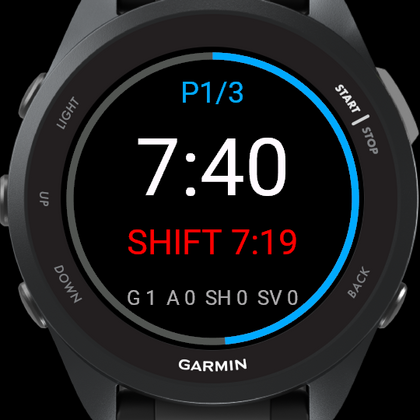
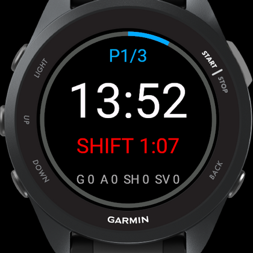
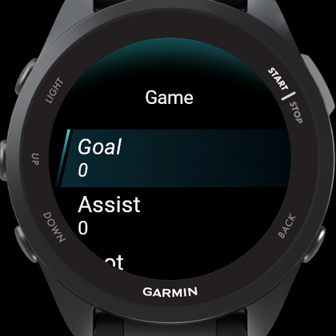

# Garmin Hockey Tracker

A Connect IQ watch app that tracks an indoor hockey game from your wrist:
period clock, shift clock, and goals / assists / shots / saves — recorded as a
real hockey activity that syncs to Garmin Connect.

Built and tested on the **Forerunner 570**. The layout is resolution-independent,
so the same build runs across the Garmin watch range.

<p align="center">
  
  
  
  
</p>
<p align="center">
  <sub>Ready &middot; running &middot; shift past target &middot; in-game menu</sub>
</p>

---

## What it does

- **Period clock** — counts down (or up), one lap per period, auto-stops at zero with a double buzz
- **Shift clock** — green → amber → red as the shift runs long, with a buzz at your target length
- **Stat counters** — goals, assists, shots, saves, with undo
- **Records a real activity** — FIT sport `hockey`, so heart rate, calories and time land in Garmin Connect
- **No GPS** — it is an indoor sport, and leaving GPS off saves the battery
- **One screen** — everything visible at a glance, no scrolling mid-game

```
        P2/3   128          period, and heart rate (or game state)
      ┌─────────────┐
        12:34             period clock
      SHIFT 0:42          green → amber → red
    G 2  A 1  SH 5  SV 0  stats so far
      └─────────────┘
          the outer ring fills as the period runs out
```

## Controls

| Button | Action |
|---|---|
| **START / SELECT** | Start, pause, or face off the next period |
| **UP** | New shift — also marks a FIT lap |
| **DOWN** | Log a shot |
| **MENU** (hold UP) | Goal, assist, shot, save, new shift, undo, next period, end game |
| **BACK** | End the game (asks first); leaves immediately if nothing is recorded |

On touch screens: tap the clock to start/pause, the shift line for a new shift,
the stat line to open the menu.

## Settings

Editable in Garmin Connect, or in the simulator under **Settings → Edit
Application Settings**.

| Setting | Default | Range |
|---|---|---|
| Periods per game | 3 | 1–9 |
| Period length (min) | 15 | 1–60 |
| Shift alert (sec) | 60 | 15–600 |
| Shift alerts | on | |
| Lap on new shift | on | |
| Count period down | on | counts up when off |

## What lands in Garmin Connect

The activity records as FIT sport `hockey` with developer fields attached:

- **Session totals** — goals, assists, shots, saves, shifts
- **One lap per shift**, each carrying that shift's length
- **A per-record field** with running shift time, so shift length is graphable

Heart rate, calories and elapsed time come from the watch's normal activity
recording.

## Install

Grab `IndoorHockey.prg` from a build and copy it to `GARMIN/APPS/` on the watch
over USB, then eject. The app appears in the activity list.

## Build from source

Requires the [Connect IQ SDK](https://developer.garmin.com/connect-iq/sdk/) and
device files, which the Garmin SDK Manager downloads after you sign in with a
Garmin account.

```bash
cd IndoorHockey
./build.sh                 # Forerunner 570 42mm
./build.sh fenix847mm      # any installed device
./run-sim.sh               # build and run in the Connect IQ simulator
TYPECHECK=3 ./build.sh     # strict type checking
```

`./sync-products.sh` rewrites `<iq:products>` in `manifest.xml` to exactly the
devices installed locally that meet the app's `minApiLevel` — run it after
adding devices, before building a store package.

### Running the tooling on Ubuntu 24.04

The SDK Manager and the simulator both link `webkit2gtk-4.0` (libsoup2).
Ubuntu 24.04 ships only `webkit2gtk-4.1` (libsoup3), and loading both into one
process aborts with `libsoup2 symbols detected`. Symlinking 4.1 as 4.0 does not
work either.

`tools/sdkmanager-docker/` solves this with an Ubuntu 22.04 container that reads
and writes the real `~/.Garmin`, so downloaded device files land where `monkeyc`
expects them:

```bash
tools/sdkmanager-docker/run.sh             # SDK Manager GUI
tools/sdkmanager-docker/run-simulator.sh   # Connect IQ simulator
```

Both honour `$DISPLAY`, so they work over X11 forwarding or against a virtual
display on a headless box.

## Layout

```
IndoorHockey/
  manifest.xml         app id, device list, permissions
  monkey.jungle        build config
  build.sh             compile for one device
  run-sim.sh           build + launch in the simulator
  sync-products.sh     regenerate the device list from what is installed
  source/
    IndoorHockeyApp.mc entry point, settings reload
    GameModel.mc       clocks, stats, alerts, the FIT session  (all state)
    GameView.mc        the one screen, plus the post-game summary
    GameDelegate.mc    buttons and taps
    GameMenu.mc        in-game menu
    Fmt.mc             time formatting
  resources/
    strings/           every user-visible string
    settings/          properties and their Garmin Connect settings UI
    drawables/         launcher icon
tools/
  sdkmanager-docker/   containerised SDK Manager + simulator
docs/
  screenshots/         simulator captures used above
```

### Design notes

All game state lives in `GameModel`; views read it and draw, holding none of
their own. Clocks are "time already banked" plus "running since", measured with
`System.getTimer()`, so pausing and resuming cannot drift.

Text is never positioned in fixed pixels. Each line picks the largest font that
fits the **chord of the circle at that height** — on a round watch the usable
width near the top and bottom is far narrower than the diameter, which is what
makes naively-sized text spill off the edge.

## Licence

MIT — see [LICENSE](LICENSE).
